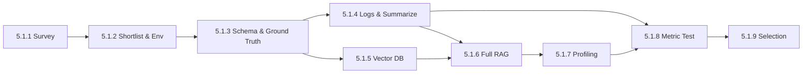
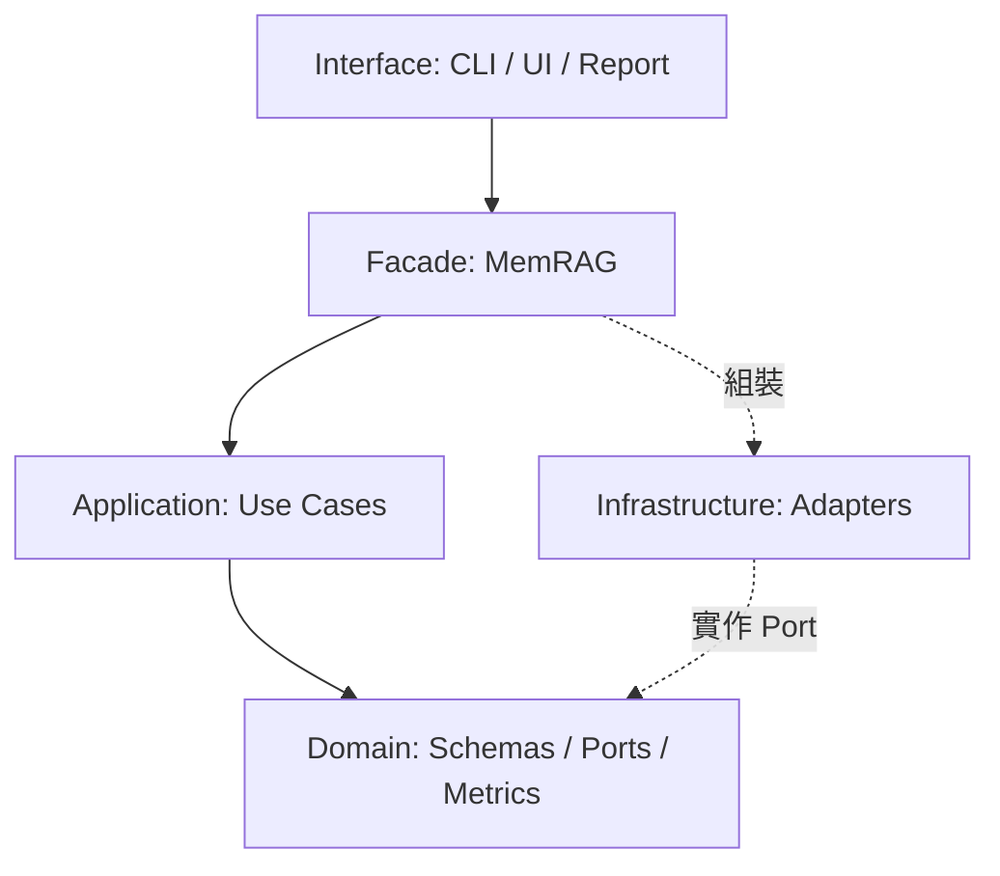
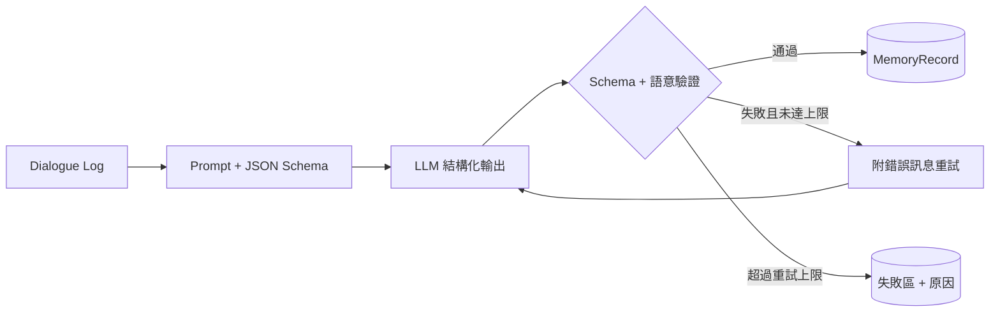

# 5.1 對話記憶 RAG：Embedding 模型評估與選型計畫書

| 項目 | 內容 |
|---|---|
| 版本 / 日期 | v0.15（草案）/ 2026-11-08 |
| 執行平台 | 開發與測試：NVIDIA Jetson Orin Nano Super（GPU）；Windows 筆電僅用於開發與遠端操作。正式部署：自架伺服器（預計在 AWS），不使用外部 API（D2） |
| 最終交付 | Embedding 模型選型決策、可重現的完整 RAG pipeline、Python Library 與手動測試介面、測試結果網頁 |
| 估計工時 | 約 21.5 人天（估計值，開始日期待定） |
| Python 套件名稱 | `memrag`（暫定） |

---

## 1. 目標與範圍

**目標：** 以日文對話記憶情境選出最適合的 Embedding 模型，並用真實 pipeline 的量測數據支持這個決定。

**範圍內**

- 候選模型調查、篩選與 CPU 載入驗證
- 記憶 Schema、測試 Query 與 Ground Truth（只做日文）
- 假對話 Log 生成與摘要（結構化輸出、驗證、重試）
- 向量資料庫與過濾檢索（`person_id` / `date` / `category`）
- 完整 RAG 串接：Log → Summarize → Embed → Store → Retrieve → LLM Answer
- 各階段延遲與記憶體量測、模型指標測試、結果分析與選型
- 分層專案結構、Library、CLI、手動測試 UI、測試結果網頁

**範圍外（本階段不做）**

- 日文以外的語言與跨語言查詢
- 正式環境部署、帳號權限與對外 HTTP API
- Reranker、Hybrid Search、Query Rewrite（選型完成後再評估）
- 模型微調、ONNX／量化最佳化
- 實際跑完整 JMTEB（僅引用公開結果）
- 真實使用者資料（本階段全部使用假資料）

---

## 2. 目前環境與待確認決策

### 2.1 執行環境：Jetson Orin Nano（2026-11-06 實測）

| 項目 | 結果 | 對計畫的影響 |
|---|---|---|
| 連線 | `ssh robo@172.28.0.147` | 所有 GPU 工作都在這台執行 |
| 機型 | Jetson Orin Nano Engineering Reference Developer Kit Super；電源模式 `MAXN_SUPER` | 正式的執行與量測平台 |
| 系統 | Ubuntu 24.04.5、L4T R39.2.1、aarch64 | 所有套件都要有 aarch64 版本 |
| CPU | 6 核 Cortex-A78AE，最高 1.73 GHz | CPU 延遲僅作備援對照 |
| 記憶體 | 7.3 GiB，**CPU 與 GPU 共用**；無 Swap | 沒有獨立 VRAM；Embedding、LLM、向量庫共用同一塊記憶體 |
| 目前可用記憶體 | 約 2.7 GiB | 2 個常駐服務佔約 4 GB，量測時暫停（D8） |
| 磁碟 | 113 GB，2026-11-07 刪除用不到的模型後剩 15 GB；5.1.2 下載 6 個模型後剩 9.7 GB；只有 `mmcblk0`，無 NVMe | 下載模型與建環境前都要檢查剩餘空間（D9） |
| GPU | Orin（nvgpu），CUDA 13.2；`nvidia-smi` 的記憶體欄為 `Not Supported` | 無法用 NVML 讀 GPU 記憶體，量測方式見 5.1.7 |
| PyTorch | 現有環境的 `torch 2.15.0+cu132`：CUDA 可用、capability 8.7、512×512 矩陣乘法實跑成功 | 已確認可用；安裝來源為 `download.pytorch.org/whl/cu132` |
| 工具 | `uv` 0.12.19（在 `~/.local/bin`，非互動 SSH 不在 PATH）、系統 Python 3.12.3（無 pip）、uv 管理的 Python 3.11.16、Docker＋nvidia runtime | 本專案用 Python 3.11：uv 快取已有 cp311 的 `torch 2.15.0+cu132`，以硬連結安裝，不另佔磁碟 |
| 套件相容性 | 2026-11-07 實裝：`torch 2.15.0+cu132`、`transformers` 5.22.2、`sentence-transformers` 6.2.0、`chromadb` 1.5.9 | `memrag env check` 通過，含 GPU 矩陣乘法與 ChromaDB 讀寫 |
| 網路 | 可連 Hugging Face 與 PyPI | 模型與套件可直接下載 |
| 共用狀況 | 家目錄已有 `50018`、`50023`、`stt-test` 等資料，看起來屬於其他人或其他專案 | 本專案放在 `~/50019/rag_test`（已建立）；D9 已刪除的模型之外，不更動其他資料 |

**開發機：** Windows 筆電（i3-10110U、約 16 GB RAM、無 NVIDIA GPU），路徑 `D:\RAG TEST`，只用於寫程式和跑快速測試，效能數據不採計。

### 2.2 需要確認的決策

未回覆時依「預設」進行，所有預設都可透過設定檔切換。**已確認：** 向量庫先用 ChromaDB（見 5.1.5）；所有 GPU 工作在 Jetson Orin Nano 執行；專案放在 `~/50019/rag_test`；Windows 專案資料全部同步到 Nano（見 2.3）；正式部署在自架伺服器，不用外部 API（D2）；系統會商用（D3）；只做日文（D6）；日文審閱由 Claude 負責（D7）；D8、D9 的處理方向；產品現用的 `bge-base-zh-v1.5` 加入當對照組（見 5.1.1）。

| # | 問題 | 預設 | 影響 |
|---|---|---|---|
| D1 | GPU 記憶體數據這樣呈現可以嗎？ | Nano 沒有獨立 VRAM，改報 PyTorch GPU 配置峰值與系統記憶體增量 | 原排程的 VRAM 欄位將採用這個定義 |
| D2 | 最終部署硬體也是這台 Nano 嗎？ | **已確認不是（2026-11-07）。** 正式部署在自架伺服器（預計在 AWS），自行執行開源模型，不使用外部 API | 檢索品質的結果直接適用。Nano 改為開發與測試平台，它的延遲與記憶體數字只作模型間的相對比較；正式數字要在部署伺服器重測。硬性門檻與權重已依此調整（見 5.1.9） |
| D3 | 系統是否會商用？ | **已確認會商用（2026-11-07）** | 非商用授權的模型不可入選；Sarashina 因此排除 |
| D4 | 生成與摘要使用哪個 LLM？ | **已確認（2026-11-07）：** 對話由 Claude 撰寫；總結用 Nano 上自己啟動的 `Qwen3-4B-Instruct-2507`（Q4_K_M，Apache-2.0），執行時暫停常駐服務。Nano 現有的 `Qwen3-1.7B`、`Qwen3.5-2B` 試寫時日文不自然、會漏掉事實，不採用 | 正式環境的總結模型還沒決定（自架，D2）；這次的語料代表「4B 級本地模型」的總結品質。正式模型確定後，可用同一套 `memrag corpus build` 重做語料再評估 |
| D5 | 回答階段的 LLM 為何？ | 與 D4 相同 | 影響 5.1.7 的 LLM 延遲是否有代表性 |
| D6 | 除日文外還要測哪些語言？ | **已確認只做日文（2026-11-07）** | 不製作其他語言與跨語言資料；多語模型仍可當候選，但只評估日文表現 |
| D7 | 誰負責第二位標註與日文審閱？ | **已確認由 Claude 負責（2026-11-07）**，做法見 5.1.3 | 不是人類母語者審閱，這項限制要寫進選型報告 |
| D8 | 常駐的 `llama-server`（:8090）與 `pocket_tts_server`（:8092）量測時可以暫停嗎？ | **已確認可以暫停。** 只在量測時停止，結束後重啟 | 暫停後估計可用約 6.5 GiB。`SIGSTOP` 不會釋放記憶體，所以實際做法是結束行程，再依各服務的 README 重啟 |
| D9 | 磁碟只剩 8.7 GB，怎麼處理？ | **已完成（2026-11-07）。** 刪除明確無人使用的 LM Studio Gemma 4 E4B GGUF（約 5.9 GiB）；其他模型都有程式引用或屬於其他專案，不刪 | 目前剩 15 GB。候選模型總大小仍限制在約 4 GB；加入對照組時預估約 4.2 GiB，使用者已同意（2026-11-07）；5.1.2 移出 GLuCoSE 後，首輪 6 個模型實際下載約 3.8 GiB。5.1.1 查到實際權重：Sarashina 約 4.6 GiB，超過 3 GiB 記憶體門檻；PLaMo 約 2.0 GiB，原本估計的 4 GB 有誤，改列備選 |
| D10 | 部署伺服器的規格？（有沒有 NVIDIA GPU、記憶體多大） | **已確認（2026-11-07）：本輪只用 Nano 測試。** 目的是找出日文最好的 Embedding 模型，伺服器規格之後再定 | 延遲與記憶體門檻沿用 Nano 的數字；選型以檢索品質為主 |
| D11 | 因 Nano 記憶體而沒列入的較大模型（`Nemotron-3-Embed-1B`、`PLaMo-Embedding-1B`）要加回嗎？ | **已確認先不加（2026-11-07）** | 首輪維持 5 個候選加 1 個對照組 |
| D12 | 記憶 JSON 要抽哪些事件欄位與 metadata？ | **已確認（2026-11-07）：** 陪伴機器人與使用者的當日對話，用模擬資料；欄位採 Claude 建議的 6 個必要欄位加 `people`，見 5.1.3 | 測試語料的 Schema 與寫法應和正式環境一致；只有 `content` 會被向量化，所以影響最大的是 `content` 的寫法與分類方式；metadata 決定能用哪些條件過濾 |

### 2.3 開發與執行流程

1. 在 Windows 的 `D:\RAG TEST` 寫程式，只跑不需要 GPU 的快速測試
2. `scripts/nano_sync.ps1` 把 `D:\RAG TEST` 同步到 Nano 的 `~/50019/rag_test`
3. `scripts/nano_run.ps1` 遠端執行測試、Profiling、指標評估
4. `scripts/nano_fetch.ps1` 取回 `results/`，新增紀錄並更新網頁的「測試結果」分頁（見第 9 節）

**同步規則：** Windows 專案資料夾內的所有資料都要同步到 Nano，只排除換平台不能用或可重建的 `.venv` 與快取資料夾。同步只新增和覆寫，不會刪除 Nano 上的檔案，以免誤刪在 Nano 產生的結果和模型；Windows 上刪除或改名的檔案要另外清理。

**帳密規則：** SSH 密碼不得寫入 repo、設定檔或文件；建議改用 SSH 金鑰登入。

---

## 3. 任務總覽

原排程僅第一項標示 5.1.1，以下依序編號為 5.1.1–5.1.9。

| 編號 | 任務 | 工時（人天） | 累計 | 相依 | 主要產出 |
|---|---|---:|---:|---|---|
| 5.1.1 | Candidate Embedding Model Survey | 1.5 | 1.5 | — | 模型調查表 |
| 5.1.2 | Candidate Shortlist & Environment Setup | 1.5 | 3.0 | 5.1.1 | 專案骨架、`models.yaml`、CPU／GPU 載入報告 |
| 5.1.3 | Memory Schema, Query Set & Ground Truth | 3.0 | 6.0 | 5.1.2 | Schema、Gold Facts、Query 集、Query 標註 |
| 5.1.4 | Dummy Log & Summarization Pipeline | 3.0 | 9.0 | 5.1.3 | 假對話、凍結的記憶語料、Qrels |
| 5.1.5 | Vector DB & Filtered Retrieval | 2.0 | 11.0 | 5.1.3 | `VectorStore` 實作、過濾檢索 |
| 5.1.6 | Full RAG Pipeline Integration | 3.5 | 14.5 | 5.1.4, 5.1.5 | 端到端流程、Context Build、Facade API、手動測試 UI |
| 5.1.7 | Pipeline Profiling | 2.0 | 16.5 | 5.1.6 | 各階段延遲與記憶體報告 |
| 5.1.8 | Embedding Model Metric Test | 3.5 | 20.0 | 5.1.4–5.1.7 | 指標結果、閾值校準、測試結果分頁的紀錄 |
| 5.1.9 | Result Analysis & Model Selection | 1.5 | 21.5 | 5.1.8 | 分析報告、ADR 決策文件 |

**工時調整（v0.8）：** 5.1.6 加 0.5 人天做閾值與 Context Build；5.1.8 加 0.5 人天做閾值校準與小候選集評估。5.1.3 增加無答案資料，但只做日文省下標註時間，工時不變。



> **排程順序注意：** Ground Truth 排在 5.1.3，但記憶內容要到 5.1.4 才產生，無法先標註 `memory_id`。本計畫改為兩段式：5.1.3 標註「Query → Gold Fact」，5.1.4 再對應「Memory → Gold Fact」，最後編譯成 Qrels。這樣維持原排程順序，也不會讓摘要結果反過來影響 Query 設計。

---

## 4. 分層架構

| 層 | 目錄 | 職責 | 可以依賴 |
|---|---|---|---|
| Interface | `memrag/interfaces/` | CLI、手動測試 UI、報告網頁產生 | Facade |
| Facade | `memrag/api.py`、`bootstrap.py` | 對外穩定 API、組裝依賴 | Application、Infrastructure |
| Application | `memrag/application/` | Use case：摘要、寫入、檢索、回答、評估、選型 | Domain |
| Domain | `memrag/domain/` | Schema、Port 介面、指標純函式，不依賴任何外部框架 | 無 |
| Infrastructure | `memrag/infrastructure/` | 模型、LLM、向量庫、量測器等實作 | Domain |



**強制規則**

1. `domain` 不得 import `torch`、`chromadb`、`sentence_transformers` 等外部框架。
2. `application` 只依賴 Port，不得 import `infrastructure`。
3. `interfaces` 只呼叫 Facade，不得繞過它直接操作底層。
4. 以 `import-linter` 把以上規則寫成測試，違反即失敗。
5. 模型資訊、路徑與門檻一律放設定檔，不寫死在程式中。

**主要 Port（`domain/ports.py`）**

Port 是 Domain 定義的介面，只規定要有哪些方法、輸入輸出是什麼，不管實際怎麼做。Application 只呼叫 Port，實際用 Chroma 還是 Fake，由 `bootstrap.py` 依設定組裝。這樣更換模型或資料庫時不用改流程程式，測試也能用 Fake 取代真實模型。

| Port | 主要方法 | 實作 |
|---|---|---|
| `EmbeddingProvider` | `embed_queries()`、`embed_documents()`、`info()` | `SentenceTransformer`、`PLaMo`、`Fake` |
| `LLMProvider` | `generate()`、`generate_structured()` | `OpenAICompatible`、`LlamaCpp`、`Replay`、`Fake` |
| `PromptStore` | `get(name, version)` | `Yaml`（讀取 `prompts/`）、`Fake` |
| `VectorStore` | `upsert()`、`search(filter)`、`stats()` | `Chroma`、`Exact`（NumPy 暴力搜尋基準） |
| `Profiler` | `stage(name)` context manager | `Psutil`＋`Tegra`（`tegrastats`、`torch.cuda`）、`Noop` |

---

## 5. 資料夾結構

```text
RAG TEST/
├── PROJECT_PLAN.md               # 計畫書（本文件）
├── README.md                     # 專案說明、資料夾導覽與快速開始
├── pyproject.toml                # 依賴、CLI 入口、pytest 與 import-linter 設定
├── uv.lock                       # 鎖定依賴版本
├── .env.example                  # API Key 範本（真實 .env 不進版控）
├── .gitignore                    # 不進版控的檔案規則
│
├── configs/                      # 設定（不含程式邏輯）
│   ├── models.yaml               # 模型 registry：revision、prefix、維度、授權
│   ├── pipeline.yaml             # top_k、Token 預算、拒答文字、重試次數、向量庫參數
│   ├── llm.yaml                  # LLM 供應商與模型
│   ├── selection.yaml            # 硬性門檻、權重與閾值校準規則（5.1.8 開跑前凍結）
│   ├── thresholds.yaml           # 各模型的相似度閾值（測試集開跑前提交）
│   └── experiments/
│       ├── smoke.yaml            # 2 模型 + 小語料，幾分鐘內跑完
│       └── full_metric.yaml      # 完整評估矩陣
│
├── prompts/                      # 所有 LLM prompt（程式內不寫 prompt）
│   ├── dialogue_generate.v1.yaml # 人物設定 + Gold Facts → 假對話
│   ├── summarize.v1.yaml         # 對話 → 記憶 JSON
│   ├── summarize_retry.v1.yaml   # 驗證失敗後要求修正
│   └── answer.v1.yaml            # 依記憶回答並附引用
│
├── src/memrag/
│   ├── __init__.py               # 匯出公開 API
│   ├── api.py                    # Facade：MemRAG
│   ├── bootstrap.py              # 依設定組裝依賴
│   │
│   ├── domain/                   # 【第 1 層】無外部框架依賴
│   │   ├── schemas/
│   │   │   ├── embedding.py      # ModelSpec, EncodedText, prefix 規則
│   │   │   ├── dialogue.py       # DialogueLog, Turn
│   │   │   ├── memory.py         # MemoryDraft（LLM 輸出）, MemoryRecord, Category
│   │   │   ├── retrieval.py      # MemoryFilter, SearchHit, Answer
│   │   │   ├── prompt.py         # PromptTemplate：代入變數、內容 hash
│   │   │   └── evaluation.py     # Persona, GoldFact, TestQuery, QueryLabel, MemoryLabel（池化審查）
│   │   ├── metrics/
│   │   │   ├── retrieval.py      # Recall@k, MRR, nDCG
│   │   │   └── statistics.py     # Cohen's κ、bootstrap 信賴區間、AUC
│   │   ├── ports.py              # Port 介面定義
│   │   └── errors.py             # 領域錯誤類別
│   │
│   ├── application/              # 【第 2 層】Use cases
│   │   ├── generate_dialogues.py # 人物設定 + Gold Facts → 假對話（這輪對話由 Claude 撰寫，未實作）
│   │   ├── llm_calls.py          # LLM 呼叫共用：快取 key
│   │   ├── summarize.py          # 結構化輸出 → 驗證 → 重試 → 對應 Gold Fact
│   │   ├── ingest.py             # 對話 → 總結 → 向量 → 儲存（失敗時不寫入）
│   │   ├── answer.py             # 過濾檢索 → 閾值 → Context Build → LLM 回答 → 檢查引用（原規劃的 retrieve／context_build／pipeline 合在這裡）
│   │   └── evaluation/
│   │       ├── dataset_check.py  # 標準答案檢查、切分、抽樣、標註一致度
│   │       ├── retrieval_eval.py # 精確搜尋的檢索評估：兩種記憶庫、三種過濾範圍、逐題指標、配對比較
│   │       ├── corpus_check.py   # 對話檢查、記憶語料的驗收數字
│   │       ├── store_check.py    # ChromaDB 對精確搜尋：過濾一致、不跨人、HNSW Recall
│   │       ├── answer_eval.py    # 完整流程的回答檢查：該答／該拒、引用、新舊記憶
│   │       ├── qrels.py          # 編譯 Qrels（目前在 retrieval_eval.py 內：記憶繼承事實分數＋池化判斷）
│   │       ├── metric_runner.py  # 模型 × 設定 測試矩陣
│   │       ├── profile_runner.py # 各階段延遲與記憶體量測
│   │       ├── thresholds.py     # 閾值校準與小候選集評估
│   │       └── selection.py      # 門檻過濾與加權排名
│   │
│   ├── infrastructure/           # 【第 3 層】外部系統實作
│   │   ├── environment.py        # memrag env check 的各項檢查
│   │   ├── embedding/
│   │   │   ├── registry.py       # 讀 models.yaml，找出已下載的固定 revision
│   │   │   ├── download.py       # 下載固定 revision 到專案的 .hf_cache
│   │   │   ├── sentence_transformer.py # Sentence Transformers 實作，統一套用 prefix
│   │   │   ├── probe.py          # 獨立子行程量測載入、記憶體與延遲
│   │   │   └── fake.py           # 測試用確定性向量
│   │   ├── llm/
│   │   │   ├── llama_server.py   # 呼叫 llama-server 的 OpenAI 相容 API（啟動由 scripts/nano_llm_session.sh 負責）
│   │   │   ├── cache.py          # 通過驗證的輸出快取，重跑免呼叫 LLM
│   │   │   └── fake.py           # 測試用：固定回應，或把使用者發言當記憶
│   │   ├── vectorstore/
│   │   │   ├── chroma_store.py   # ChromaDB 內嵌模式實作
│   │   │   └── exact_store.py    # 精確搜尋，指標測試基準
│   │   ├── profiling/
│   │   │   ├── psutil_profiler.py # 系統記憶體與 RSS 取樣
│   │   │   └── tegra_profiler.py # tegrastats、torch.cuda（Jetson 用）
│   │   ├── prompts.py            # 依名稱與版本讀取 prompts/
│   │   └── storage/
│   │       ├── jsonl_repo.py     # 讀寫 JSONL 資料
│   │       └── manifest.py       # 內容 hash、環境與版本紀錄
│   │
│   └── interfaces/               # 【第 4 層】使用者入口
│       ├── cli/
│       │   ├── main.py           # `memrag` 指令入口
│       │   └── commands/         # embed, search, ask, summarize, eval...
│       ├── ui/
│       │   └── app.py            # 手動測試 UI（Gradio）
│       └── report/
│           ├── builder.py        # 把紀錄寫入計畫書網頁的測試結果分頁
│           ├── loaders.py        # 讀 JUnit、coverage、run 結果
│           ├── templates/        # Jinja2 版型
│           └── static/           # 內嵌用 CSS/JS
│
├── tests/
│   ├── architecture/             # 分層依賴規則、README 完整性
│   ├── unit/
│   │   ├── domain/               # 指標以手算結果驗證
│   │   ├── application/          # 搭配 Fake 測流程與重試
│   │   └── infrastructure/       # 設定檔驗證等不需外部資源的部分
│   ├── contract/                 # 同一 Port 的所有實作都要通過同一組測試
│   ├── integration/              # 真實 Chroma、小模型
│   ├── e2e/                      # 全流程（Fake 與真實各一）
│   ├── benchmark/                # slow：效能與指標
│   └── fixtures/                 # 小型日文樣本、LLM 錄製回應
│
├── data/                         # 依流程階段編號
│   ├── 00_gold/                  # personas, gold_facts, queries, labels（兩次標註）、抽樣清單
│   ├── 01_dialogues/             # 假對話 Log
│   ├── 02_memories/              # 凍結的記憶語料
│   ├── 03_qrels/                 # 編譯後的相關性標註、小候選集定義
│   └── manifests/                # 資料版本與 hash
│
├── results/runs/<run_id>/        # 單次執行的原始結果（不進版控）
│   ├── manifest.json             # commit、模型 revision、資料 hash、硬體
│   ├── load_probe.jsonl          # 5.1.2 模型載入量測
│   ├── junit.xml / coverage.json # pytest 結果與覆蓋率
│   ├── profile.jsonl             # 各階段延遲與記憶體
│   └── metrics.json / per_query.jsonl # 整體與單筆 Query 指標
│
├── reports/
│   ├── overview.json             # 分頁「總覽」：結論、本期重點、模型比較總表、任務進度
│   ├── log/                      # 2026-11-07 以前的過程紀錄存檔，不放上網頁
│   └── records/                  # 實驗結果，一次實驗一檔（進版控）
│       └── <日期>_<主題>.json     # 網頁下拉選單的一個項目
│
├── docs/
│   ├── survey/                   # 5.1.1：model_survey.md、mteb_japanese_retrieval.json
│   ├── schema/memory_schema.md   # 5.1.3
│   ├── annotation_guide.md       # 5.1.3
│   ├── annotation_review.md      # 5.1.3：兩次標註的分歧裁決與日文審閱紀錄
│   ├── manual_testing.md         # 手動測試手冊
│   ├── project_plan.html         # 計畫書網頁的原始檔，含測試結果分頁
│   ├── analysis/selection_report.md  # 5.1.9
│   └── adr/0001-embedding-model.md   # 5.1.9
│
└── scripts/                      # 只放薄包裝腳本，邏輯留在 src/
    ├── run_all.sh                # 在 Nano 執行：測試 → Profiling → 評估
    ├── nano_services.sh          # 在 Nano 執行：量測前停止、量測後重啟常駐服務（D8）
    ├── nano_measure.sh           # 在 Nano 執行一次量測，結束時一定重啟服務
    ├── nano_sync.ps1             # Windows → Nano 同步全部專案資料
    ├── build_results_tab.ps1     # 把紀錄寫入網頁，memrag report build 完成後移除
    ├── nano_run.ps1              # 從 Windows 遠端執行
    └── nano_fetch.ps1            # Nano → Windows 取回結果
```

**README 規則**

上面的結構為了易讀省略了 `README.md`，實際上**每一層資料夾都要有一份**，包含 `src/memrag/` 的各層，以及 `tests/`、`data/`、`configs/` 的子資料夾。

- **內容：** 說明資料夾的用途，並用表格列出裡面的每個檔案和子資料夾，欄位為名稱、類型、說明、產生方式、是否進版控。
- **同步更新：** 新增、刪除或改名檔案時，要在同一次提交更新該資料夾的 README。
- **大量同類檔案：** 格式相同的資料檔可以用檔名模式說明，例如 `dialogue_*.json`，但要寫清楚格式和數量來源。
- **例外：** `.git`、`.venv`、快取資料夾不需要 README。`results/runs/<run_id>/` 是自動產生的，檔案格式由 `results/README.md` 說明。
- **自動檢查：** `tests/architecture/test_readme_coverage.py` 檢查每個資料夾都有 README，且每個檔案都有列出，缺漏就讓測試失敗。

**Prompt 規則**

- **封裝：** 所有 LLM prompt 都放在 `prompts/`，程式只用名稱和版本讀取，例如 `prompt_store.get("summarize", version="v1")`。架構測試會檢查 `src/` 沒有明顯寫死的 prompt，審查時也要確認。
- **版本：** 檔名為 `<名稱>.v<版本>.yaml`。凍結後內容不再變動，要修改就新增版本。
- **測試目的：** 這輪的比較對象是 Embedding 模型，prompt 只是固定條件，不比較版本，也不找最佳 prompt。只確認流程跑得通、語料達到 5.1.4 驗收，通過後凍結，所有模型共用同一份語料。
- **不放在 `prompts/` 的內容：** Embedding 模型的 query／document prefix 屬於模型規格，放在 `configs/models.yaml`。

---

## 6. Library 與手動測試介面

同一份功能提供三種入口，底層都走 `MemRAG` Facade，避免手動測試與自動測試的行為不一致。

### 6.1 Python Library

```python
from memrag import MemRAG, MemoryFilter

rag = MemRAG.from_config("configs/pipeline.yaml", embedding_model="ruri-v3-130m")

# 匯入一份對話 Log：摘要 → 向量化 → 儲存
report = rag.ingest_log("tests/fixtures/dialogue_ja_001.json")
print(report.accepted, report.rejected, report.retries)

# 過濾檢索
hits = rag.search(
    "田中さんの好きな食べ物は？",
    filters=MemoryFilter(person_id="p001", category="preference", date_from="2026-01-01"),
    top_k=5,
)

# 完整回答（含引用來源與各階段耗時）
answer = rag.ask("田中さんの好きな食べ物は？", filters=MemoryFilter(person_id="p001"))
print(answer.text, answer.citations, answer.timings_ms)

# 除錯：查看實際送進模型的文字（確認 prefix）
print(rag.explain_embedding("田中さん", kind="query").encoded_text)
```

公開 API 只從 `memrag/__init__.py` 匯出；其他模組視為內部實作，可自由調整。

### 6.2 CLI

```powershell
uv run memrag env check                       # 環境、模型快取、GPU 狀態
uv run memrag models list                     # 候選模型與 prefix
uv run memrag models download --models all    # 下載固定 revision（只在 Nano 上）
uv run memrag models probe --devices cuda,cpu # 每個模型在獨立子行程量測載入、記憶體與延遲
uv run memrag prompt list                     # 所有 prompt 與版本
uv run memrag prompt show summarize --version v1 # 查看 prompt 內容與 hash
uv run memrag embed "こんにちは" --model ruri-v3-130m --kind query --explain
uv run memrag dataset validate                # 標準答案的格式與一致性檢查、統計
uv run memrag dataset show-query q_p01_05     # 查看一題與它的相關事實
uv run memrag dataset agreement               # 兩次標註的 Cohen's κ
uv run memrag dialogues validate              # 每筆 Gold Fact 在正確的人、正確的日期出現一次
uv run memrag summarize d_p01_1027 --show-retries # 總結一場對話，列出每次嘗試與驗證錯誤
uv run memrag corpus build                    # 總結全部對話並凍結到 data/02_memories（Nano，用 nano_llm_session.sh）
uv run memrag eval run --models all --split dev --corpus memories # 檢索準確度（gold：事實原文；memories：LLM 記憶）
uv run memrag eval rescore results/runs/<run_id> # 標註更新後，沿用存下的向量重算
uv run memrag eval calibrate results/runs/<dev run> --write # 校準閾值，寫入 configs/thresholds.yaml
uv run memrag eval thresholds results/runs/<test run> # 用固定閾值評估小候選集
uv run memrag select --retrieval <test run> --thresholds <threshold run> --probe <probe run> # 依 selection.yaml 選型
uv run memrag store build --model ruri-v3-130m  # 把記憶庫寫進 results/vector_db（ChromaDB）
uv run memrag store check results/runs/<memories run> # ChromaDB 對精確搜尋：過濾一致、不跨人、HNSW Recall
uv run memrag search "好きな食べ物" --model ruri-v3-130m --person p01 --category preference -k 5
uv run memrag ingest d_p01_1027 --model ruri-v3-130m # 對話 → 總結 → 向量 → 寫入向量庫（Nano，LLM session）
uv run memrag ask "ラーメン、今もよく食べてる？" --person p06 --today 2026-11-01 --trace # 完整問答（Nano，LLM session）
uv run memrag eval answers --split dev        # 每題跑完整流程，檢查該答／該拒、引用與新舊記憶
uv run memrag profile --config configs/experiments/smoke.yaml
uv run memrag eval --config configs/experiments/full_metric.yaml
uv run memrag report add --run <run_id>       # 新增一筆測試紀錄
uv run memrag report build --open             # 更新並開啟網頁的測試結果分頁
uv run memrag ui                              # 啟動手動測試 UI（先 uv sync --extra ui，只綁定 127.0.0.1）
```

所有指令都支援 `--json`，方便接腳本；錯誤訊息要指出是哪個階段、哪筆資料出錯。Nano 的非互動 SSH 找不到 `uv`，遠端執行時要用 `~/.local/bin/uv`，由 `nano_run.ps1` 處理。

### 6.3 手動測試 UI（Gradio，僅綁定 `127.0.0.1`）

UI 跑在 Nano 上，從 Windows 建立 SSH 通道後，再用瀏覽器開 `http://127.0.0.1:7860`：

```powershell
ssh -L 7860:127.0.0.1:7860 robo@172.28.0.147
```

| 分頁 | 給測試者的功能 |
|---|---|
| Embedding | 輸入文字、選模型與 kind，查看 prefix、維度、耗時，比較兩句相似度 |
| Summarize | 貼上對話 Log，查看 LLM 原始輸出、驗證錯誤、重試過程、最終記憶 |
| Search | 設定 `person_id` / `date` / `category` / `top_k`，查看分數、是否通過閾值與 metadata |
| Compare | 同一 Query 並排比較多個模型的檢索結果 |
| Ask | 完整問答，顯示通過閾值的記憶、Context、引用與各階段耗時 |
| Feedback | 把手動發現的問題 Query 存成候選，**審閱後**才可加入 Query 集 |

### 6.4 手動測試手冊

`docs/manual_testing.md` 為每項任務列出：操作指令、預期結果、實際結果欄與常見問題，讓沒參與開發的人也能在 15 分鐘內完成冒煙測試。手動測試結果另存為 JSON，每次都新增一筆紀錄，顯示於網頁的測試結果分頁。

---

## 7. 各任務工作內容

每項任務都要同時交付：功能程式、Library/CLI 入口、測試、手冊章節、所有變動資料夾的 README；有實驗結果的任務，還要把結果放上測試結果分頁（見第 9 節）。

### 5.1.1 Candidate Embedding Model Survey

**工作項目**

- 彙整日文專用與多語模型（多語模型只評估日文表現）：大小、維度、最大長度、授權、prefix 規則、依賴、是否需 `trust_remote_code`
- 從 MTEB Leaderboard 的 Japanese 分頁記錄 JMTEB 分數，**優先看 Retrieval 類別**
- 每筆資料附來源連結、查閱日期、模型 revision

**調查結果（2026-11-07）**

完整內容與來源見 `docs/survey/model_survey.md`。下表的分數是 MTEB 結果庫 7 個共同日文資料集的 nDCG@10 平均，由本調查自算；「—」表示沒有可比較的分數。這些都是公開資料，**尚未在 Nano 上實測**。

| 模型 | 權重 | 維度 | 授權 | 分數 | 建議 |
|---|---:|---:|---|---:|---|
| `cl-nagoya/ruri-v3-30m` | 140 MiB | 256 | Apache 2.0 | 81.94 | 首輪 |
| `cl-nagoya/ruri-v3-130m` | 504 MiB | 512 | Apache 2.0 | 83.80 | 首輪 |
| `cl-nagoya/ruri-v3-310m` | 1,200 MiB | 768 | Apache 2.0 | 83.98 | 首輪 |
| `pkshatech/GLuCoSE-base-ja-v2` | 508 MiB | 768 | Apache 2.0 | — | 首輪；5.1.2 移出（tokenizer 與 transformers 5 不相容） |
| `Qwen/Qwen3-Embedding-0.6B` | 1,136 MiB | 1024 | Apache 2.0 | 80.30 | 首輪 |
| `intfloat/multilingual-e5-small` | 449 MiB | 384 | MIT | 72.71 | 首輪 |
| `google/embeddinggemma-300m` | 1,155 MiB | 768 | Gemma，需同意條款 | 81.28 | 備選 |
| `nvidia/Nemotron-3-Embed-1B-BF16` | 2,176 MiB | 2048 | OpenMDW-1.1 | — | 備選 |
| `pfnet/plamo-embedding-1b` | 2,004 MiB | 2048 | Apache 2.0 | — | 備選 |
| `cl-nagoya/ruri-v3-70m` | 267 MiB | 384 | Apache 2.0 | 82.45 | 不列入 |
| `pkshatech/RoSEtta-base-ja` | 726 MiB | 768 | Apache 2.0 | — | 不列入 |
| `BAAI/bge-m3` | 2,166 MiB | 1024 | MIT | 79.59 | 不列入 |
| `sbintuitions/sarashina-embedding-v1-1b` | 4,669 MiB | 1792 | **非商用** | 83.84 | 不列入（D3、記憶體） |
| `sbintuitions/sarashina-embedding-v2-1b` | 4,669 MiB | 1792 | **非商用** | 85.54 | 不列入（D3、記憶體） |
| `LiquidAI/LFM2.5-Embedding-350M` | 676 MiB | 1024 | LFM Open，有營收限制 | — | 不列入 |

首輪 6 個的權重合計約 3.84 GiB，符合 D9 的預算。

**對照組（2026-11-07 使用者確認）：** 加入產品現用的 `BAAI/bge-base-zh-v1.5`（390 MiB、768 維、MIT）。它是中文模型，不參與選型，只用來看換模型能改善多少。加入後總權重約 4.2 GiB，略超預算，使用者已同意。

**驗收：** 候選至少 8 個且日文專用與多語都涵蓋；每一欄都有來源；授權風險已標示。

**狀態：** 調查完成。5.1.2 已建好 Library，但列出調查表全部模型的 `--source survey` 還沒做。

**手動測試：** `memrag models list --source survey`

### 5.1.2 Candidate Shortlist & Environment Setup

**工作項目**

- 建立第 5 節的專案骨架（每個資料夾附 README）、`git init`、架構測試與 README 檢查、Windows 與 Nano 的同步腳本
- 在 Nano 的 `~/50019/rag_test`（已建立）用 `uv` 建環境並安裝 CUDA 版 PyTorch（`cu132` 索引）
- 把模型 **revision 固定為 commit hash**，`HF_HOME` 指向專案資料夾，不動共用快取；下載後以離線模式執行
- 需要 `trust_remote_code` 的模型：先閱讀遠端程式碼並固定 revision，才可載入
- 把 prefix 規則寫入 `models.yaml`，由 registry 統一套用，不在業務程式中手動拼接
- 在獨立子行程量測每個模型的 CUDA 與 CPU 載入：載入時間、記憶體峰值、單句延遲、最長輸入行為
- 從 5.1.1 建議的首輪 6 個開始，依授權、Nano 的記憶體與磁碟可行性、多樣性，確定 **4–6 個**，權重總大小約 4 GB 內（見 D9）
- 確認所有模型能否共用同一個 `transformers` 版本；不能的話，用獨立環境或調整名單

```yaml
# configs/models.yaml（節錄）
ruri-v3-130m:
  hf_id: cl-nagoya/ruri-v3-130m
  revision: e3114c6ee10dbab8b4b235fbc6dcf9dd4d5ac1a6
  role: candidate          # baseline 只當對照組
  dim: 512
  max_seq_length: 512      # 記憶不超過 200 字，統一截在 512
  query_prefix: "検索クエリ: "
  document_prefix: "検索文書: "
  dtype: float32           # CUDA 精度；CPU 一律 float32
  trust_remote_code: false
  license: Apache-2.0
  commercial_ok: true
```

**驗收：** Nano 全新環境可用 `uv sync` 後跑通 `memrag env check`，其中包含實際的 GPU 運算；`chromadb` 在 aarch64 實裝並通過讀寫測試；每個入選模型都通過 CUDA 與 CPU 載入；Prefix 契約測試通過；落選原因有記錄。

**手動測試：** `memrag embed "テスト" --model <name> --kind query --explain`

**結果（2026-11-07）**

首輪名單確定為 5 個候選加 1 個對照組，6 個模型下載後共約 3.8 GiB。數字是單次量測（`run_id 20261107-183526_load_probe`），常駐服務已停止；系統記憶體峰值包含約 0.7 GiB 的 CUDA 固定開銷。

| 模型 | 角色 | CUDA 精度 | CUDA 單句 p95 | CUDA 系統記憶體峰值 | CPU 單句 p95 |
|---|---|---|---:|---:|---:|
| `ruri-v3-30m` | 候選 | float32 | 17.9 ms | 938 MiB | 23.1 ms |
| `ruri-v3-130m` | 候選 | float32 | 30.9 ms | 917 MiB | 77.6 ms |
| `ruri-v3-310m` | 候選 | float32 | 39.9 ms | 1,450 MiB | 172.5 ms |
| `qwen3-emb-0.6b` | 候選 | bfloat16 | 83.6 ms | 1,356 MiB | 435.4 ms |
| `e5-small` | 候選 | float32 | 19.8 ms | 1,688 MiB | 37.9 ms |
| `bge-base-zh-v1.5` | 對照組 | float32 | 20.0 ms | 734 MiB | 104.6 ms |
| `GLuCoSE-base-ja-v2` | 移出 | — | — | — | — |

- **GLuCoSE 移出：** transformers 5.x 的 MLukeTokenizer 無法正確載入它（5.22 報錯，5.0 的 Token ID 全錯），而 sentence-transformers 6.2 要求 transformers 5.x。另建 transformers 4.x 環境才能用，但之後每次向量化都要跨環境呼叫，所以首輪不採用；模型檔已依使用者指示從 Nano 刪除（釋放 508 MiB，磁碟剩 9.7 GB）。
- **其他模型都可行：** CUDA 單句 p95 都在 500 ms 門檻內，系統記憶體峰值都低於 3 GiB 門檻（只含 Embedding）。
- **精度：** CUDA 用權重原生精度，Qwen3 是 bfloat16；CPU 一律 float32。所有向量都轉成 float32 後再正規化，避免低精度造成的長度誤差。
- **bge 的 query 指令：** 依 model card 的檢索建議加上，產品實際用法待確認。

**狀態：** 驗收項目全部達成：Nano 全新環境的 `env check`、ChromaDB 讀寫、6 個模型的 CUDA 與 CPU 載入、Prefix 契約測試（Nano 上 111 項全部通過）、落選原因都有紀錄。程式已提交到 git（2026-11-07 首次提交）。

### 5.1.3 Memory Schema, Query Set & Ground Truth

**情境（D12，2026-11-07 確認）：** 陪伴機器人每天把和使用者的對話總結成幾筆記憶，存進向量庫；之後使用者說話時，機器人依這句話找出相關記憶。全部用模擬資料。

**記憶 Schema（Pydantic，附 `schema_version`，詳見 `docs/schema/memory_schema.md`）**

| 欄位 | 型別 | 來源 | 說明 |
|---|---|---|---|
| `category` | enum | LLM | 8 類，見下表；可用來過濾 |
| `content` | str | LLM | 1–2 句日文記憶，**唯一被向量化的欄位** |
| `event_date` | date \| null | LLM | 事件發生或預定的日期（ISO 8601），可用日期範圍過濾 |
| `people` | list[str] | LLM | 記憶中提到的人，例如 `["孫の結衣"]`；沒有就是空清單 |
| `source_turn_ids` | list[int] | LLM | 證據對話輪次，用來檢查摘要有沒有亂編 |
| `person_id` | str | 程式 | 對話的使用者；機器人一定知道在跟誰說話，所以由程式依對話 Log 填入，不讓 LLM 判斷 |
| `conversation_date` | date | 程式 | 這筆記憶來自哪一天的對話 |
| `memory_id` | str | 程式 | 依內容產生的穩定 ID |
| `event_date_ord` | int \| null | 程式 | `YYYYMMDD` 整數，供範圍過濾 |
| `source_log_id` | str | 程式 | 來源對話 |
| `schema_version` | str | 程式 | Schema 版本 |
| `gold_fact_ids` | list[str] | 評估資料 | 僅評估時使用，不給 LLM 看 |

| `category` | 日文 | 內容 |
|---|---|---|
| `event` | 出来事 | 當天或過去發生的事 |
| `plan` | 予定 | 未來的安排 |
| `preference` | 好み | 喜歡或討厭的東西 |
| `relationship` | 人間関係 | 家人、朋友、寵物 |
| `health` | 健康・体調 | 身體狀況、睡眠、服藥 |
| `emotion` | 気持ち | 情緒、擔心的事 |
| `routine` | 習慣 | 日常作息 |
| `profile` | プロフィール | 住處、職業、出身等基本資料 |

LLM 只輸出前 5 個欄位（`MemoryDraft`），其餘由程式補上。`importance`、`emotion` 這類選用 metadata 本輪不做。這輪 Schema 是固定條件，不比較不同格式。

**Query 集（目標 150–200 筆，全部日文）**

| 類別 | 佔比 | 測試重點 |
|---|---:|---|
| 直接事實 | 20% | 基本檢索 |
| 改寫／同義 | 20% | 語意能力 |
| 日文表記與語體 | 20% | 漢字／假名、敬語／口語、縮寫 |
| 人物限定 | 15% | 相似內容屬於不同人 |
| 時間與類型限定 | 15% | 日期與 category 過濾 |
| 無答案 | 10% | 不該找到相關記憶，包含「別人有這筆記憶、本人沒有」 |

**無答案資料與小候選集**

只有 150–200 筆 Query 時，人工無答案題太少，無法校準閾值，所以另外由程式產生。這些資料不計入上表，也不增加標註量。

- **程式產生的無答案題：** 把有答案 Query 的相關記憶（分級 ≥ 1）全部從候選中移除，就成為「有相似記憶但沒有正確答案」的難題。
- **小候選集：** 每筆 Query 從同一個人的記憶抽出 2、5、10、50 筆候選，每種抽 5 次（暫定），固定亂數種子。有答案組保留相關記憶，無答案組全部移除。定義檔放在 `data/03_qrels/` 並進版控。

**Ground Truth 流程（兩段式）**

1. 先定義 Gold Facts，作為生成對話的「事實清單」
2. 標註 `Query → Gold Fact`，分級：`2` 直接回答、`1` 部分相關、`0` 不相關
3. 5.1.4 完成後對應 `Memory → Gold Fact`，再編譯成 Qrels
4. 5.1.8 用各模型 top-k 聯集做一次池化審查（Pooling），補上遺漏的相關記憶，降低標註偏差

**日文審閱與第二次標註（D7）**

1. **審閱 Query 和 Gold Facts：** 檢查日文是否自然、敬語與口語是否符合類別、表記差異是否真的存在，問題逐筆列出並修正。
2. **第二次標註：** 另開一個 Claude 工作階段，只提供標註指南和資料，不提供第一次的標註，獨立標註至少 20% 的樣本，再計算 Cohen's κ。
3. **處理分歧：** 依標註指南裁決並記錄理由；指南不清楚的地方要修改指南。
4. **抽查語料：** 5.1.4 完成後抽查至少 5% 的記憶，檢查日文是否自然、有沒有混入中文、內容是否符合來源對話。

**限制：** Claude 不是日文母語者，兩次標註也來自同一個模型，κ 可能偏高，只能當標註指南是否清楚的參考。選型報告要寫明這項限制；日後能找到日文母語者時，再抽查一部分 Query。

**驗收：** 標註指南完成；至少 20% 樣本完成第二次獨立標註且 Cohen's κ ≥ 0.7（暫定）；日文 Query 經審閱，問題與修改都有紀錄；Query 集切分為開發集（調流程）與測試集（只用於最終評估）。

**手動測試：** `memrag dataset validate`、`memrag dataset show-query <id>`

**結果（2026-11-07）**

| 項目 | 結果 |
|---|---|
| 模擬使用者 | 20 人，8–91 歲，含關西腔、京都腔與小孩的說話方式；全部虛構 |
| Gold Facts | 400 筆（每人 20 筆），8 種 `category` 都有；9 組事實更新（`supersedes`） |
| 測試問題 | 201 題：直接 40、改寫 40、表記與語體 40、人物限定 37、時間與類型 24、無答案 20 |
| 標註 | 267 筆（2 分 201、1 分 66），沒列出的配對是 0 分 |
| 切分 | 依問題類型分層：開發集 81 題、測試集 120 題 |
| 第二次獨立標註 | 50 題（25%），Cohen's κ 0.90（裁決前，全部 1,000 組配對）；只看任一方標為相關的配對 κ 0.63 |
| 日文審閱 | 27 項（高 0、中 12、低 15），全部處理 |

- **刻意設計的干擾：** 不同人有相似的事實（孫來訪、釣魚、看眼科、健康檢查、鄰居），讓「人物限定」題能測出不加 `person_id` 過濾時會不會拿錯人的記憶；無答案題多半問「別人有、本人沒有」的事。
- **審閱抓到的出題錯誤：** 3 題在 11/1 說「来月」卻指 11 月的預定，已改成「今月」；另有 2 個日期與日間照護的星期衝突、1 個年齡算錯，都已修正。
- **指南修訂：** 兩次標註主要的分歧是背景事實該給 1 分還是 0 分。指南改成 1 分只給同一件事的舊版本、感受、其他步驟、治療所針對的狀況或部分回答，並依此重新檢查全部標註，把 25 筆背景事實改成 0 分。
- **限制：** 兩次標註都是 Claude，不是日文母語者，κ 可能偏高。

詳細的裁決與審閱紀錄見 `docs/annotation_review.md`。

**狀態：** 驗收項目全部達成：標註指南完成；25% 樣本完成第二次獨立標註且 κ 0.90 ≥ 0.7；日文經審閱，問題與修改都有紀錄；已切分開發集與測試集。

### 5.1.4 Dummy Log Generation & Summarization Pipeline

**假對話生成**

- 以「人物設定＋Gold Facts → 對話」的順序生成，**事實先於對話**，避免 Ground Truth 循環依賴
- 規模（2026-11-07 依 5.1.3 的 Gold Facts 調整）：20 人、390 場對話（每人每天一場，每場 1–2 筆事實）。原訂約 1,500–3,000 筆記憶，因為事實只有 400 筆，實際記憶約 400–500 筆
- 撰寫者（D4）：Claude 依人物設定與事實撰寫；部分日期用「昨日」「来週の日曜日」等相對說法，測試總結時的日期換算；閒聊不加入新的個人資訊，以免產生沒有標註的記憶
- 刻意加入干擾：不同人的相似內容、事實更新（喜好改變）、閒聊雜訊
- 固定亂數種子；全部使用虛構資料與日文對話

**記憶切分規則**

不做固定長度切片，由 LLM 一次把整份對話轉成記憶清單。這些規則是固定條件，所有模型共用同一份語料。

- 每筆只記一件事，寫成 1–2 句，不超過 200 字（暫定）
- 每筆要能單獨看懂：用人名取代代名詞，相對日期換成絕對日期
- 事實有變化時新增一筆，不改寫舊記憶
- 這輪不加標題，只對 `content` 做 Embedding

**摘要流程**



**驗證規則**

- Schema：型別、列舉值、必填欄位
- 語意：`person_id` 確實出現在該 Log；`source_turn_ids` 存在；日期在合理範圍；`content` 非空、不超過上限且含假名（擋下被翻成中文的輸出）；相同內容去重
- 重試：最多 3 次，把驗證錯誤回饋給 LLM；網路錯誤採指數退避；記錄每次原始輸出
- 快取：以 `hash(輸入對話 + prompt 全文 + 模型 + 參數)` 做 key，參數包含 temperature、seed 與輸出 Schema。任何一項改變就重新呼叫 LLM；驗證失敗的輸出不重用
- LLM：自行啟動獨立的 `llama-server` 實例（:8095，不共用 :8090 的服務，`scripts/nano_llm_session.sh`），並驗證 JSON Schema 約束輸出是否可用
- 對應 Gold Fact：對話的 `fact_turns` 記錄每筆事實在哪幾句；記憶引用的句子（`source_turn_ids`）落在哪筆事實的句子，就對應到那筆事實。記憶繼承來源事實的最高分，作為 5.1.8 的 Qrels

**驗收（數值暫定）：** 最終成功率 ≥ 99%；第一次通過率 ≥ 90%；Gold Fact 覆蓋率 ≥ 90%，未覆蓋項目逐筆列出；重試與失敗路徑都有測試；語料凍結並記錄 hash。

**狀態：** 驗收項目全部達成（run_id `20261107-231513_summarize`）。390 場對話全部成功、第一次就通過；641 筆記憶，Gold Fact 覆蓋率 98%，未覆蓋的 8 筆列在 `data/02_memories/corpus_manifest.json`；語料 sha256 `2bd13bef…`。總結品質：類別 75%、有日期事實的 `event_date` 77% 與事實一致，16% 的記憶留著相對日期，這些錯誤不修正。`summarize.v1` 已凍結。

**手動測試：** `memrag dialogues validate`、`memrag summarize <log_id> --show-retries`、`memrag corpus build --limit 17`

### 5.1.5 Vector DB Setup & Filtered Retrieval

**選型（已確認）：** 先用 ChromaDB 內嵌模式，理由是免另外架服務、會在行程內建 HNSW 索引（能量測索引時間），且支援 `$gte` / `$lte` / `$in` / `$and`。另提供 `ExactStore` 作為精確基準。其他資料庫日後只需實作 `VectorStore`。

**工作項目**

- 每個模型＋維度使用獨立 collection：`mem__{model}__{dim}`，距離固定 cosine
- `MemoryFilter` 轉換成各資料庫語法，不把 Chroma 語法外洩到 Application 層
- 日期範圍用 `event_date_ord` 整數比較
- Upsert 具備冪等性，重跑不產生重複資料
- 驗證 collection 與模型維度一致，防止混用向量

**驗收：**

- 單一與組合過濾的結果都與 `ExactStore` 一致
- **`person_id` 過濾 100% 不跨人**（含屬性測試）
- 無結果與 `event_date` 為空時，行為符合文件
- 分別記錄 HNSW 相對於精確搜尋的 Recall

**手動測試：** `memrag store build --model ruri-v3-130m`，再 `memrag search "..." --model ruri-v3-130m --person p01 --category event --from 2026-10-01 --to 2026-10-31`

**狀態：** 驗收項目全部達成（2026-11-08，`memrag store check`，run_id `20261108-012345_store_check`、Nano `20261108-012751_store_check`）。6 個模型、每個 540 組過濾（300 組隨機的單一與組合過濾＋每題兩種範圍）與精確搜尋接受的記憶完全相同；只搜本人時不跨人；HNSW Recall@10 不過濾 0.996–1.000、搭配 person_id 過濾 1.000；upsert 冪等；沒有日期的記憶存 `event_date_ord = 0`，任何日期條件都會排除它，沒有結果時回傳空清單。測試：`tests/integration/test_chroma_store.py`。

### 5.1.6 Full RAG Pipeline Integration

**工作項目**

- 串接 Log → Summarize → Embed → Store → Retrieve → LLM Answer，並完成 `MemRAG` Facade
- 回答附 `memory_id` 引用；這輪只檢查引用是否正確，不評估回答品質
- 每次執行產生 `manifest.json`（commit、資料 hash、模型 revision、prompt hash、閾值、設定、硬體）
- 各階段可單獨重跑；失敗時訊息指出階段與資料 ID
- 完成手動測試 UI

**檢索到回答的流程**

```text
Query + prefix → Embedding → person_id／日期過濾 → cosine 排序取 Top-k
→ 閾值過濾 → Context Build → LLM 回答 → 檢查引用
```

- **沒有記憶通過閾值：** 程式直接回傳拒答文字「関連する情報はありません」，不呼叫 LLM
- **有記憶通過閾值：** LLM 仍可判斷這些記憶沒有回答到問題，回傳相同的拒答文字，作為第二層防線
- **尚未校準的模型：** 不套用閾值，並在 trace 標示 `uncalibrated`
- **過濾的用法（2026-11-08 依開發集決定）：** 一定依 `person_id` 過濾；日期過濾在記憶沒有事件日期時改看記錄日（`date_fallback: true`，78% 的記憶沒有事件日期）；不使用類別過濾（總結的類別只有 75% 正確）。開發集 nDCG@10：只過濾本人 0.610、嚴格日期過濾 0.573、改看記錄日 0.739；測試集確認 0.855 對 0.595
- **新舊記憶並存：** Context 每筆附記錄日，prompt 規定內容衝突時以記錄日較新的為準
- **閾值的用法（2026-11-09 依開發集決定）：** 手動測試發現逐筆套用閾值會把更新後的事實擋在 Context 外（ラーメン：10/24「月に二回まで」0.836 < 0.849，LLM 只看到舊記憶）。`eval answers` 並排比較 `per_memory`（只送通過閾值的記憶）、`gate`（閾值只決定要不要呼叫 LLM，第一名通過就送全部 Top-k）與不用閾值；`gate` 每一項都不輸 `per_memory`，採用 `threshold_mode: gate`，閾值維持 0.849
- **拒答文字：** LLM 常用自己的話拒答（「記録に…ありません」），被算成有回答；`answer.v1` 加上「只寫固定拒答文字、不可換句話說、不可斷定記憶沒寫的事」後凍結
- **Nano 記憶體：** 2026-11-08 評估時 Nano 卡住約 3.5 小時，核心紀錄顯示最後由 OOM killer 砍掉 llama-server。原因是 llama-server 預設把處理過的 prompt 的 KV 狀態存在主記憶體（`--cache-ram` 預設 8192 MiB）；`nano_llm_session.sh` 改用 `--cache-ram 0`、問答用 `LLM_CTX=4096`、Embedding 用 CPU，並在可用記憶體低於 500 MiB 時自動停止

**Context Build（固定做法，不呼叫 LLM，這輪不比較不同做法）**

1. 去除內容相同的記憶
2. 依相似度排序；超過預算時從最低分開始捨棄，預算是 1,200 字（`pipeline.yaml` 的 `context_budget_chars`），Top-k 是 5
3. 格式化成 `[m_…] 記録日：2026-10-27／種類：preference／日付：…／内容：…`，送給 `answer.v1` prompt

**驗收：** Fake 版端到端測試可在 CI 等級時間內跑完且不需網路；真實版至少跑通 3 個日文案例（有答案、完全無關、相似但沒有答案）；同設定與同資料重跑，檢索結果一致；引用的 `memory_id` 全部存在且屬於過濾範圍內。

**手動測試：** `memrag ask "..." --person p06 --today 2026-11-01 --trace`，或 UI 的 Ask 分頁；步驟見 `docs/manual_testing.md` 的 5.1.6 章節

**狀態：** 驗收項目全部達成（2026-11-09，run_id `20261109-104034_answer_eval`，開發集＋測試集 201 題）。採用的 gate＋閾值 0.849：無效引用與過濾範圍外引用都是 0；201 題重跑檢索結果相同；三個手動案例跑通。輔助觀察（這輪不評估回答品質）：無答案題測試集 14/14 拒答；可回答題有回答 71%，約 3 成被閾值擋下（多半是時間題與全平假名的問題）；新舊衝突測試集只答對 1/4。Nano 上問題 Embedding p50 113 ms、檢索 7 ms、LLM p50 2.6 s。`answer.v1` 已凍結。

### 5.1.7 Pipeline Profiling

**量測項目**

| 階段 | 延遲 | 記憶體 |
|---|---|---|
| Log 讀取、摘要、驗證 | 總耗時、重試次數 | RSS |
| 模型載入 | 冷啟動時間 | 系統記憶體增量、GPU 配置峰值 |
| Document Embedding | 筆／秒、不同 batch size | 系統記憶體增量、GPU 配置峰值 |
| Store／Index Build | 總耗時 | 峰值 RSS、磁碟大小 |
| Query Embedding、Retrieve | P50／P95 | RSS |
| Context Build | P50／P95 | RSS |
| LLM Answer | 首 token 時間、token／秒、總耗時 | 系統記憶體增量（llama.cpp 無法用 `torch.cuda` 量測） |

**量測規範**

- 每個模型在**獨立子行程**執行，避免前一模型的記憶體未釋放而污染數據
- 系統記憶體（`MemAvailable`）與 RSS 由背景執行緒以固定間隔（約 50 ms）取樣，記錄峰值與基準值
- GPU 配置用 `torch.cuda.max_memory_allocated/reserved`；`tegrastats` 同步記錄 `GR3D_FREQ`、溫度與 `VDD_IN` 功耗
- 統一記憶體下，RSS 與 GPU 配置不可直接相加（可能重複計算），判斷門檻一律看系統記憶體增量
- 丟棄 warm-up；至少重複 3 次；固定執行緒數、維持 `MAXN_SUPER`；`jetson_clocks` 需要 sudo 且會改變系統設定，要先徵得同意
- 量測前確認沒有其他人在跑工作，再依 D8 停止兩個常駐服務，把服務狀態寫入 manifest
- 量測後重啟服務並確認恢復：`llama-server` 的 `/health` 回 200，`pocket_tts_server` 印出 `TTS_READY`；量測中途失敗也要重啟
- 雲端 LLM 的延遲另外標示，不與本地運算混算
- 量不到的欄位記為 `N/A`（不是 0）

**檢索階段與向量庫規模測試（2026-11-09 新增，草案）**

目的：量「問題 → 取得 Top-k 記憶」這段的速度與資源，比較 Top-k 3 與 5，並確認資料量變大、過濾條件變多時，ChromaDB 是否仍是合適的選擇。目前的檢索就是依 cosine 相似度（向量已正規化，等於內積）取最高的 K 筆，用 HNSW 近似搜尋；沒有 MMR、Reranker 或 BM25。

*實驗 A：檢索階段（現有資料：641 筆記憶、201 題）*

| 變因 | 值 |
|---|---|
| Top-k | 3、5 |
| Embedding 裝置 | CPU、GPU（兩個都量） |
| 向量庫 | ChromaDB（HNSW）、精確搜尋（`ExactStore`，逐筆計算） |

- **分段計時：** 問題加 prefix 與 Embedding、metadata 過濾＋搜尋、取回完整記憶；另外記錄冷啟動（第一題，含模型載入）
- **指標：**

| 指標 | 量法 |
|---|---|
| Query Latency | 各段與總計的 P50／P95／P99 |
| QPS | 依序連續送題的每秒題數；機器人一次服務一人，以延遲為主 |
| Peak RAM | 行程峰值 RSS、系統 `MemAvailable` 下降量；GPU 時加記 `torch.cuda` 配置峰值 |
| Index Size | 向量庫資料夾的磁碟大小、載入後的記憶體增量 |
| Build Time | Document Embedding 與寫入索引分開計時 |
| Recall@K | 品質：正確記憶（2 分）是否在前 K 名，用現有標註；近似誤差：HNSW 前 K 名與精確搜尋的重疊率 |

- **預期：** Top-k 3 與 5 的檢索時間差距很小（時間主要花在問題 Embedding），Top-k 主要影響 Recall 與送給 LLM 的 Context 長度；Context 長度與 LLM 讀 prompt 的時間一併記錄

*實驗 B：資料量與 metadata 過濾的成本（擴充資料）*

- **資料：** 把 641 筆記憶複製擴充成 **1k、10k、50k** 筆，分配給不同的虛擬使用者並平移日期；向量加入微小雜訊後重新正規化，避免完全相同的向量影響 HNSW。速度與記憶體不需要新的標註；擴充資料上的 Recall 只量 HNSW 對精確搜尋的重疊率
- **每人筆數：** 依「每人約 100／1,000／5,000 筆」安排（5,000 筆約等於一人每天 5 筆、用 3 年）
- **過濾條件（依篩選後剩下的比例設計）：** 不過濾、只看使用者、使用者＋日期範圍（一週／一個月）、使用者＋日期 fallback（`$or`，現行做法）、類別、多值條件（`$in`，多個類別或人物）
- **量什麼：** 每種資料量 × 過濾條件 × 向量庫的延遲（P50／P95）、峰值記憶體、索引大小、建置時間、HNSW 對精確搜尋的 Recall@K
- **Metadata 欄位的取捨：** 效能只看每種過濾條件要付出的時間與記憶體；某個欄位對回答有沒有幫助，只能在有標註的現有資料上評估（例如 5.1.6 的類別過濾反而變差）。候選欄位：`person_id`、`event_date`、`conversation_date`（現有）、`people`（已存但未用來過濾）、被取代標記、敏感度

*向量庫的比較順序*

1. 先比 ChromaDB 與精確搜尋。精確搜尋在 5 萬筆、512 維時約 100 MB，若在最大資料量下 P95 仍明顯低於問題 Embedding 的時間，代表可以不需要 HNSW
2. 兩者都有明顯問題時，再加入 sqlite-vec、LanceDB 或 FAISS＋SQLite 比較；Qdrant 需要另外跑伺服器，Nano 記憶體吃緊，列最後

*執行方式（暫定）*

- `memrag profile retrieval`（實驗 A）與 `memrag profile scale`（實驗 B），設定放 `configs/experiments/`，結果寫入 `results/runs/<run_id>_profile_*`
- 在 Nano 用 `nano_measure.sh` 執行（暫停常駐服務、結束後一定重啟）；不載入 LLM。實際部署時 LLM 與 Embedding 同時在 Nano 上，「LLM 已載入時的 GPU Embedding」另外量一組
- 工時：預估比原本的 5.1.7 多約 1 人天（待確認）

**適用範圍（D2）：** 正式部署在自架伺服器，Nano 上的數字只用來比較模型之間的相對差異與找出瓶頸階段。部署伺服器確定後，用同一套 `memrag profile` 在伺服器上重跑，得到正式數字。

**驗收：** 各階段耗時加總與端到端總耗時差距 < 5%；Profiler 開銷經量測並記錄；報告明確列出瓶頸階段。檢索與規模測試：實驗 A、B 的每個組合都有數字或明確的 `N/A` 原因；HNSW 對精確搜尋的 Recall@K 有記錄；結論寫明是否繼續用 ChromaDB。

**手動測試：** `memrag profile --config configs/experiments/smoke.yaml`，或 `memrag ask ... --trace`

### 5.1.8 Embedding Model Metric Test

**先凍結再開跑：** Query 測試集、語料、門檻、權重與閾值校準規則都要在執行前提交版控，避免看到結果後才改標準。

**測試矩陣**

| 維度 | 內容 |
|---|---|
| 模型 | 5.1.2 入選的 4–6 個 |
| 裝置 | CUDA 為主；綜合前 2 名另測 CPU，作為備援參考 |
| 搜尋方式 | Exact（比較模型品質）、HNSW（評估實際部署） |
| 過濾 | 無過濾、`person_id`、`person_id` + `date`/`category` |
| 分組 | Query 類別、候選數（2、5、10、50、該人全部記憶） |

**指標定義**

| 指標 | 定義 |
|---|---|
| Recall@k（k=1,3,5,10） | Top-k 找到的相關記憶數 ÷ 全部相關記憶數，取 Query 平均 |
| MRR@10 | 第一個相關結果排名倒數的平均 |
| nDCG@10 | 使用分級標註（0/1/2）的排序品質 |
| Query Latency | Query Embedding + 搜尋，單筆 P50／P95 |
| Index Build Time | 語料向量化時間與索引建立時間，分開記錄 |
| Memory | 系統記憶體增量、PyTorch GPU 配置峰值、RSS、索引磁碟大小 |
| 無答案查詢 | 不計入以上檢索指標，改用下面的閾值指標評估 |

**統計方法：** 指標以 Query 為單位做配對 Bootstrap，計算 95% 信賴區間。差距落在信賴區間內視為無顯著差異，不宣稱勝出。

**閾值校準與小候選集評估**

候選很少時，Top-k 一定會回傳記憶，Recall 卻幾乎都是 100%，看不出誤檢索。例如某人只有兩筆記憶，問題卻和兩筆都無關，最高分的那筆仍會送給 LLM。所以閾值要另外評估；上面的排序指標在閾值之前計算，不受影響。不同模型的分數不能互比，每個模型要各校準一個閾值。

1. 完成開發集的 Pooling 後，在開發集候選 2–10 筆的組合上掃描分數，選出無答案誤召回率 ≤ 5%（暫定）的最低閾值。
2. 把各模型的閾值寫入 `configs/thresholds.yaml`，在測試集開跑前提交。
3. 用固定閾值在測試集依候選數分組回報。這一步使用已算好的向量，不需要重新 Embedding，也不呼叫 LLM。

| 指標 | 定義 |
|---|---|
| 無答案誤召回率 | 無答案題中，至少一筆記憶通過閾值的比例 |
| 正確記憶誤擋率 | 有答案題中，沒有任何相關記憶通過閾值的比例 |
| 錯誤記憶通過率 | 通過閾值的記憶中，不相關的比例 |
| Top-1 錯誤率 | 有答案題中，最高分不是相關記憶的比例 |

**限制：** 閾值無法保證零錯誤。一對一錯且兩筆分數都高時擋不住，只能靠 LLM 判斷；閾值太高則會擋掉正確記憶。如果錯誤率仍然太高，下一輪再評估 Reranker。

**公平性控制**

- 統一 `max_seq_length`（上限 512，確認語料不被截斷）
- 所有向量做 L2 正規化；所有模型統一使用 float32（5.1.2 載入量測時 Qwen3 用的是 bfloat16，指標測試要改用 float32）
- 語料已凍結，指標測試不載入 LLM，記憶體只反映 Embedding 與向量庫；兩者並存的情況由 5.1.7 量測
- 每個模型套用模型卡規定的 prefix，並寫入 manifest
- 先用 `smoke.yaml` 預估時間，再啟動完整矩陣

**驗收：** 指標函式通過手算案例，並與第三方函式庫（如 `ranx`）交叉驗證；完整矩陣都有結果或明確的失敗原因；每筆 Query 都能下鑽查看各模型結果；結果已寫入網頁的測試結果分頁。

**手動測試：** UI 的 Compare 分頁、`memrag eval --query <id> --explain`

**預評估：以 Gold Facts 當記憶庫（2026-11-07 加入）**

使用者決定先測 Embedding 模型，不等 5.1.4 的 LLM 總結。做法是把 400 筆 Gold Facts 的原文直接當記憶庫，這相當於「總結完全正確」的理想情況，結果只反映 Embedding 模型本身。只用開發集，測試集保留到正式評估。

- 指令：`memrag eval run --models all --split dev`；所有模型 float32、精確 cosine 搜尋
- 三種搜尋範圍：不過濾（20 人共 400 筆）、只搜本人、本人加題目的日期／類別過濾
- 指標：nDCG@10、Recall@k、MRR@10，以及 Bootstrap 95% 信賴區間與逐題配對比較；無答案題只算第一名分數的 AUC，正式的閾值指標之後再做
- 5.1.4 完成後，用 LLM 總結出的記憶再跑一次，比較兩者的排名是否一致

**狀態：** 開發集在兩種記憶庫都評估完成。

- **Gold Facts 記憶庫**（run_id `20261107-221101_retrieval_eval`），只搜本人時 nDCG@10：ruri-v3-310m 0.945、ruri-v3-30m 0.931、Qwen3 0.921、ruri-v3-130m 0.920、e5-small 0.871、bge-base-zh-v1.5 0.780
- **LLM 記憶庫**（5.1.4 的 641 筆，run_id `20261107-235108_retrieval_eval_memories`，池化後重算 `20261107-235741_retrieval_rescore`）：ruri-v3-310m 0.902、ruri-v3-130m 0.888、ruri-v3-30m 0.868、Qwen3 0.851、e5-small 0.751、bge-base-zh-v1.5 0.680
- 兩種記憶庫的排名一致，前四名的信賴區間重疊；LLM 記憶庫上日期／類別過濾會擋掉 metadata 有誤的正確記憶，時間題約 0.6（Gold Facts 上是 1.0）
- **池化審查（2026-11-08 完成，開發集）：** 每題取 6 個模型前 5 名（無答案題前 3 名），對沒有對應到事實或繼承了分數的 400 組記憶重新判斷，寫在 `data/02_memories/pool_labels.jsonl`；35 組調高、8 組調低
- **閾值校準與小候選集（2026-11-08 完成，開發集）：** 每題抽 2–10 筆的候選集（正例含 1 筆 2 分記憶，負例全是 0 分；有答案題拿掉相關記憶也當負例，因為無答案題只有 8 題），校準無答案誤召回 ≤ 5% 的最低閾值，寫入 `configs/thresholds.yaml`（run_id `20261108-004204_threshold_calibration`）。正確記憶誤擋率：ruri-v3-130m 29%、ruri-v3-310m 32%、ruri-v3-30m 34%、Qwen3 35%、e5-small 48%、bge 61%；單靠閾值會擋掉約 3 成的正確記憶，5.1.6 要保留 LLM 判斷這一層
- **測試集（2026-11-08 完成）：** 閾值與 `selection.yaml` 在評估前提交（commit `2022cb6`）。LLM 記憶庫、只搜本人 nDCG@10：ruri-v3-310m 0.872、ruri-v3-130m 0.864、Qwen3 0.863、ruri-v3-30m 0.859（差距不顯著）、e5-small 0.815、bge 0.690；測試集池化 585 組。固定閾值下無答案誤召回 4.6%–6.9%（下限都 ≤ 5%），正確記憶誤擋 31.7%（130m）到 53.3%（bge）
- 指標函式通過手算案例；與 `ranx` 的交叉驗證、HNSW 還沒做

### 5.1.9 Result Analysis & Embedding Model Selection

**兩階段決策（`selection.yaml`，數值暫定，開跑前凍結）**

1. **硬性門檻：** 授權符合 D3；`person_id` 過濾無跨人錯誤；小候選集（2–10 筆）的無答案誤召回率，在測試集的 95% 信賴區間下限 ≤ 5%。記憶體與延遲的上限依部署伺服器規格（D10）訂定；規格確定前暫用 Query P95 ≤ 500 ms、Embedding 加向量庫的記憶體 ≤ 3 GiB，以 Nano 數字判斷
2. **加權排名（2026-11-07 依 D2 調整）：** 正式環境是自架伺服器，資源比 Nano 寬裕，所以提高檢索品質的比重、降低延遲與記憶體的比重；索引建置時間只在資料寫入時發生，改為只回報、不計分

| 面向 | 權重 | 調整前 |
|---|---:|---:|
| nDCG@10 | 40% | 35% |
| Recall@5 | 25% | 20% |
| 小候選集（2–10 筆）正確記憶誤擋率，越低越好 | 20% | 15% |
| Query Latency | 10% | 15% |
| 記憶體 | 5% | 10% |
| Index Build Time | 不計分 | 5% |

**決策規則：** 前幾名差距未達顯著時，選擇較輕量、授權較單純的模型。

**工作項目**

- 比較各模型的強弱項與失敗案例（例如表記差異、小候選集的誤檢索）
- 權重敏感度分析：權重上下變動後第一名是否改變
- 比較本專案結果與 JMTEB 參考值，解釋差異
- 提出主選與備選，寫明不適用情境與重新評估條件

**驗收：** `selection_report.md` 與 ADR 完成；報告數字都能追溯到 `run_id`；審閱者能依文件重現主要結果。

**狀態：** 依凍結規則的排名完成（`memrag select`，run_id `20261108-010358_selection`）。5 個候選都通過硬性門檻；加權分數 ruri-v3-130m 0.920、ruri-v3-30m 0.874、ruri-v3-310m 0.751、Qwen3 0.608、e5-small 0.097，權重 ±0.05 第一名不變；前四名 nDCG 差距不顯著，依平手規則也選較輕量的 ruri-v3-130m。初步結論：主選 ruri-v3-130m、備選 ruri-v3-30m。選型報告（`docs/analysis/selection_report.md`，含失敗案例、穩健性檢查與 JMTEB 比較，排名相關 0.90）與 ADR 0001 已完成；ADR 經專案負責人同意，2026-11-08 改為「已採用」。5.1.5–5.1.7 的確認結果補在 ADR 的「採用後的確認」，觸發重新評估條件時改回提議中。

---

## 8. 測試策略

| 類型 | 目錄 | 內容 | 是否需要模型或網路 | 執行時機 |
|---|---|---|---|---|
| Architecture | `tests/architecture` | 分層依賴規則、每個資料夾的 README 完整性 | 否 | 每次 |
| Unit | `tests/unit` | Schema、指標、重試、過濾轉換 | 否 | 每次 |
| Contract | `tests/contract` | Port 實作行為一致、prefix 正確 | Fake 否；真實模型為 `slow` | 每次／選用 |
| Integration | `tests/integration` | 真實 Chroma、小模型 | 需 Nano 上的模型快取 | 提交前 |
| E2E | `tests/e2e` | 全流程（Fake／真實） | Fake 否；真實需要 | 提交前／里程碑 |
| Benchmark | `tests/benchmark` | 效能與指標 | 需要 | 手動 |
| Manual | `docs/manual_testing.md` | 人工驗證 | 視項目而定 | 里程碑 |

**測試必須覆蓋的高風險案例**

- `person_id` 過濾絕不跨人
- Query 與 Document prefix 不會用反或遺漏
- 不同維度或模型的向量不會寫進同一 collection
- LLM 回傳無效 JSON、缺欄位、幻覺證據時能正確重試或拒絕
- 日文全形／半形、長文截斷、空字串與 emoji
- 指標在無相關文件、結果少於 k 等邊界情況的行為
- 沒有記憶通過閾值時不呼叫 LLM，直接回傳拒答文字
- Context Build 超過 Token 預算時捨棄最低分的記憶，且輸出順序固定
- Prompt 缺少變數時報錯；prompt 內容改動後不會讀到舊快取

**執行位置：** Architecture、Unit 與 Fake 版測試在 Windows 或 Nano 都可以跑；Integration、真實 E2E 與 Benchmark 只在 Nano 跑。

**任務對應：** 每個測試用 marker 標示所屬任務，測試結果分頁依此分組。

```python
@pytest.mark.task("5.1.5")
def test_person_filter_never_leaks_other_person(): ...
```

---

## 9. 測試結果網頁

**位置：** 不另外開網站，直接在現有的[計畫書網頁](https://claude.ai/artifact/6BzFmMb5emzFfcpyz8Lpiz)新增分頁。網頁分成「計畫書」和「測試結果」兩個分頁，「測試結果」頂端用一個下拉選單切換每一次的主題。

**用途：** 在週會報告實驗結果，所以只放模型比較、準確度、效能與選型結論，不放每一個操作步驟（2026-11-07 使用者決定）。

**紀錄規則**

- **放上網頁：** 模型調查與篩選、模型效能量測、檢索指標評估、選型分析。每次正式實驗一筆，重跑也算新的一筆。
- **不放上網頁：** 環境檢查、開發中的自動測試、模型下載、手動測試、修 bug 的過程。需要追查時看 git 紀錄與 `results/runs/`。2026-11-07 以前已寫的 15 筆過程紀錄移到 `reports/log/` 存檔，之後不再新增。
- **不挑結果：** 實驗結果不好、中途失敗或發現問題，都要寫在該次實驗紀錄裡並說明原因，例如模型因相容性問題被移出。
- **只增不改：** 舊紀錄不覆寫。發現錯誤時新增一筆修正紀錄，並和原紀錄互相連結。
- **完成條件：** 紀錄寫入、總覽的模型比較表更新、網頁發布、同步到 Nano 都做完，這次實驗才算完成。
- **內容限制：** 不放密碼、API Key 或真實個資。

**下拉選單**

- **第一項「總覽」：** 給週會直接使用：目前選型結論、本期重點、模型比較總表、下一步、任務進度、實驗紀錄清單。
- **其他項目：** 依任務分組，最新的在前，每項顯示 `日期｜主題｜狀態`，例如 `2026-11-07｜模型載入量測與首輪名單｜通過`。
- **直接連結：** 網址帶紀錄 ID（`#record=<id>`），可以直接分享某一筆。

**每筆紀錄的內容**

| 欄位 | 內容 |
|---|---|
| 主題、ID、日期時間 | 這次做了什麼，以及何時做的 |
| 任務、類型、狀態 | 所屬任務 5.1.x；類型見下表；狀態為通過、失敗、部分完成、中止或資訊 |
| 目的 | 想回答什麼問題 |
| 環境與版本 | 機器、服務狀態、`run_id`、commit、模型 revision、資料 hash；沒有的欄位記為 `N/A` |
| 做法 | 實際執行的指令或查閱的來源 |
| 結果 | 依類型呈現，暫定門檻與最終門檻要標示區分 |
| 結論與下一步 | 這次結果代表什麼、接下來要做什麼 |
| 原始資料 | `results/runs/<run_id>/` 路徑或來源連結與查閱日 |

**依類型呈現的結果**

| 類型 | 結果內容 | 主要資料來源 |
|---|---|---|
| 模型調查 | 模型大小、維度、授權、prefix、JMTEB 分數、篩選理由 | 模型卡、MTEB Leaderboard |
| 模型篩選 | 入選或移出的理由與證據，例如相容性檢查 | 實測輸出 |
| 效能量測 | 各模型或各階段的延遲與記憶體、瓶頸標示 | `load_probe.jsonl`、`profile.jsonl` |
| 指標評估 | 指標總表、信賴區間、Recall@k 曲線、分組分析、閾值與小候選集結果、單筆 Query 下鑽 | `metrics.json`、`per_query.jsonl` |
| 選型分析 | 門檻結果、加權排名、敏感度分析、ADR 連結 | selection |

**更新流程**

```text
Nano 執行並產生 results/runs/<run_id>/
→ nano_fetch.ps1 取回 Windows
→ memrag report add --run <run_id>   # 新增 reports/records/ 的紀錄
→ memrag report build                # 更新 docs/project_plan.html 的測試結果分頁
→ 發布到同一個網址 → nano_sync.ps1 同步到 Nano
```

- **沒有 `run_id` 的紀錄：** 模型調查這類工作用 `memrag report add --type survey --from <檔案>` 新增。
- **`memrag report` 做好之前：** 紀錄與 `overview.json` 手動維護，再用 `scripts/build_results_tab.ps1` 寫入網頁。
- **一鍵流程：** Nano 上的 `scripts/run_all.sh` 依序執行 `pytest`、`memrag profile`、`memrag eval`，結果再照上面的流程處理。
- **離線與權限：** `docs/project_plan.html` 的資料都內嵌在檔案內，雙擊就能離線開啟；只有流程圖要連網載入，離線時會顯示原始文字。線上網頁預設是私人的，要從 Share 開放權限，其他人才能看。
- **檔案大小：** 線上網頁上限 16 MB。建置時檢查大小，超過 12 MB 就把較舊紀錄的單筆 Query 明細移出網頁，改成指向 `results/` 的路徑；`reports/records/` 的紀錄本身不變。

**目前網頁上的實驗（2026-11-07）**

| 日期 | 主題 | 類型 | 任務 |
|---|---|---|---|
| 2026-11-07 | 候選 Embedding 模型調查 | 模型調查 | 5.1.1 |
| 2026-11-07 | 模型載入量測與首輪名單 | 效能量測 | 5.1.2 |
| 2026-11-07 | GLuCoSE 與 transformers 5 相容性檢查 | 模型篩選 | 5.1.2 |

---

## 10. 風險與對策

| 風險 | 影響 | 對策 |
|---|---|---|
| 共用 7.3 GiB 記憶體且無 Swap | 行程被 OOM 終止，也可能波及同機服務 | 量測時依 D8 暫停服務；每個模型獨立子行程；batch size 由小往上試；不自行加 Swap（需 sudo） |
| 磁碟只剩 15 GB | 模型或環境裝不下、影響其他專案 | 依 D9 限制候選大小；下載前檢查剩餘空間；保留安全餘量；其他專案的模型不動 |
| 共用機器上有其他工作 | 互相干擾、數據失真 | 開跑前檢查負載與服務狀態並寫入 manifest；長時間測試先通知其他使用者 |
| 讀不到獨立的 GPU 記憶體 | 原排程 VRAM 欄位無法照原定義交付 | 改用 PyTorch 配置峰值＋系統記憶體增量（D1） |
| 大型模型或語料處理太慢 | 評估時間失控 | 5.1.2 實測；設定單模型時間上限；Embedding 結果依 hash 快取；排程在夜間執行 |
| Jetson 的 PyTorch 相容性資料分歧 | 重裝後可能跑不動 GPU | 沿用已實測成功的 `2.15.0+cu132`；`uv.lock` 鎖版本；`env check` 實跑 GPU 運算 |
| `robo` 在 sudo 群組且密碼強度不足 | 區網內的帳號安全風險 | 建議更換密碼並改用 SSH 金鑰；密碼不進 repo 或文件 |
| 本地 LLM 過慢 | 生成與摘要無法完成 | 可切換 Provider；結果快取；測試使用 Replay |
| 摘要輸出混入中文 | 日文語料品質下降，比較結果失真 | Prompt 明確要求日文；驗證要求含假名；Claude 抽查語料（D7） |
| 閾值擋不住高分的錯誤記憶，或擋掉正確記憶 | LLM 引用錯誤記憶，或有答案的問題被拒答 | 誤召回與誤擋分開回報並納入選型；LLM 判斷與引用檢查作為第二層；必要時下一輪評估 Reranker |
| 溫度或頻率變動 | 延遲數據不穩 | 以 `tegrastats` 記錄溫度與頻率、重複量測、報告變異量；只在同機比較 |
| `mmcblk0` 儲存的 I/O 較慢 | 模型載入與索引時間受儲存影響 | 報告註明儲存類型；若之後換 NVMe，這兩項要重測 |
| 標註集偏向特定模型 | 指標失真 | 事實先於對話、兩次獨立標註、池化審查、測試集隔離 |
| 沒有人類日文審閱 | 不自然的日文或標註偏差沒被發現 | 獨立工作階段重新標註；報告寫明限制；日後由日文母語者抽查 |
| 假資料與真實對話有差距 | 結論外推受限 | 刻意加入雜訊與表記差異；報告明列此限制；日後用獲授權的真實資料複測 |
| `trust_remote_code` 安全風險 | 執行不受信任程式碼 | 閱讀程式碼、固定 revision、離線執行 |
| 模型或依賴更新導致結果變動 | 無法重現 | 固定 revision、`uv.lock`、manifest |
| 看到結果後調整標準 | 選型偏誤 | 門檻、權重與測試集開跑前提交版控 |
| 公開榜單資料與本專案情境不同 | 誤判候選 | JMTEB 僅用於篩選參考，最終以本專案測試為準 |
| 測試平台（Nano）與部署伺服器不同 | 延遲、記憶體數字不能直接套用到正式環境 | 選型以檢索品質為主；效能只比較模型間的相對差異；部署伺服器確定後重跑 `memrag profile`（D2、D10） |

---

## 11. 完成定義（Definition of Done）

- [ ] 任務 5.1.1–5.1.9 的驗收條件全部達成，或偏差已記錄並獲同意
- [ ] 分層架構測試通過，資料夾結構與第 5 節一致，每個資料夾都有 README 並列出所有檔案
- [ ] 他人可依 `README.md` 從全新環境完成安裝並跑通冒煙測試
- [ ] Library、CLI、手動測試 UI 三種入口都可完成 Embed、Search、Ask
- [ ] `manual_testing.md` 由非開發者實際操作驗證過一次
- [ ] 每一次實驗（模型調查與篩選、效能量測、指標評估、選型分析）都有紀錄，可從測試結果分頁的下拉選單查看，包含結果不佳或中止的實驗
- [ ] Nano 上的 `run_all.sh` 可一鍵跑完測試與評估，結果取回 Windows 後可更新網頁，網頁也能離線開啟
- [ ] 專案結束時 Nano 上只新增 `~/50019/rag_test`；暫停的服務都已重啟；除 D9 已刪除的模型外，未更動其他專案、服務或系統設定
- [ ] 選型報告與 ADR 完成，數字都可追溯到 `run_id`
- [ ] Repo 內沒有 API Key、真實個資或大型模型檔

---

## 12. 參考資料（查閱日 2026-11-06、2026-11-07）

- [JMTEB GitHub](https://github.com/sbintuitions/JMTEB)：v2.0 使用 MTEB 引擎、28 個資料集，榜單移至 MTEB Leaderboard
- [MTEB Leaderboard](https://huggingface.co/spaces/mteb/leaderboard)：General Purpose → Language-specific → Japanese
- [JMTEB 論文（LREC 2026）](https://aclanthology.org/2026.lrec-1.588/)
- [MTEB 結果庫](https://github.com/embeddings-benchmark/results)：5.1.1 的逐資料集分數來源
- 新候選模型卡：[Qwen3-Embedding-0.6B](https://huggingface.co/Qwen/Qwen3-Embedding-0.6B)、[Nemotron-3-Embed-1B](https://huggingface.co/nvidia/Nemotron-3-Embed-1B-BF16)、[LFM2.5-Embedding-350M](https://huggingface.co/LiquidAI/LFM2.5-Embedding-350M)
- 模型卡：[ruri-v3-310m](https://huggingface.co/cl-nagoya/ruri-v3-310m)、[GLuCoSE-base-ja-v2](https://huggingface.co/pkshatech/GLuCoSE-base-ja-v2)、[RoSEtta-base-ja](https://huggingface.co/pkshatech/RoSEtta-base-ja)、[PLaMo-Embedding-1B](https://huggingface.co/pfnet/plamo-embedding-1b)、[Sarashina-Embedding-v1-1B](https://huggingface.co/sbintuitions/sarashina-embedding-v1-1b)、[multilingual-e5-small](https://huggingface.co/intfloat/multilingual-e5-small)、[BGE-M3](https://huggingface.co/BAAI/bge-m3)、[EmbeddingGemma](https://huggingface.co/google/embeddinggemma-300m)
- [Chroma Metadata Filtering](https://docs.trychroma.com/docs/querying-collections/metadata-filtering)
- Jetson PyTorch（社群資料有分歧，本計畫以 Nano 實測結果為準）：[JetPack 7.2 安裝討論](https://forums.developer.nvidia.com/t/how-do-i-correctly-install-pytorch-on-jetpack-7-2/372773)、[jetson-jp7.2-install](https://github.com/iuliaferoli/jetson-jp7.2-install)、[Jetson SBSA PyTorch Wheels](https://johnnynunez.github.io/projects/jetson-sbsa-pytorch)
